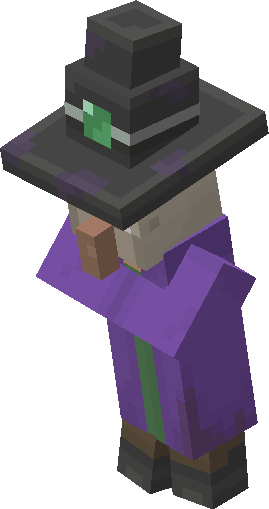
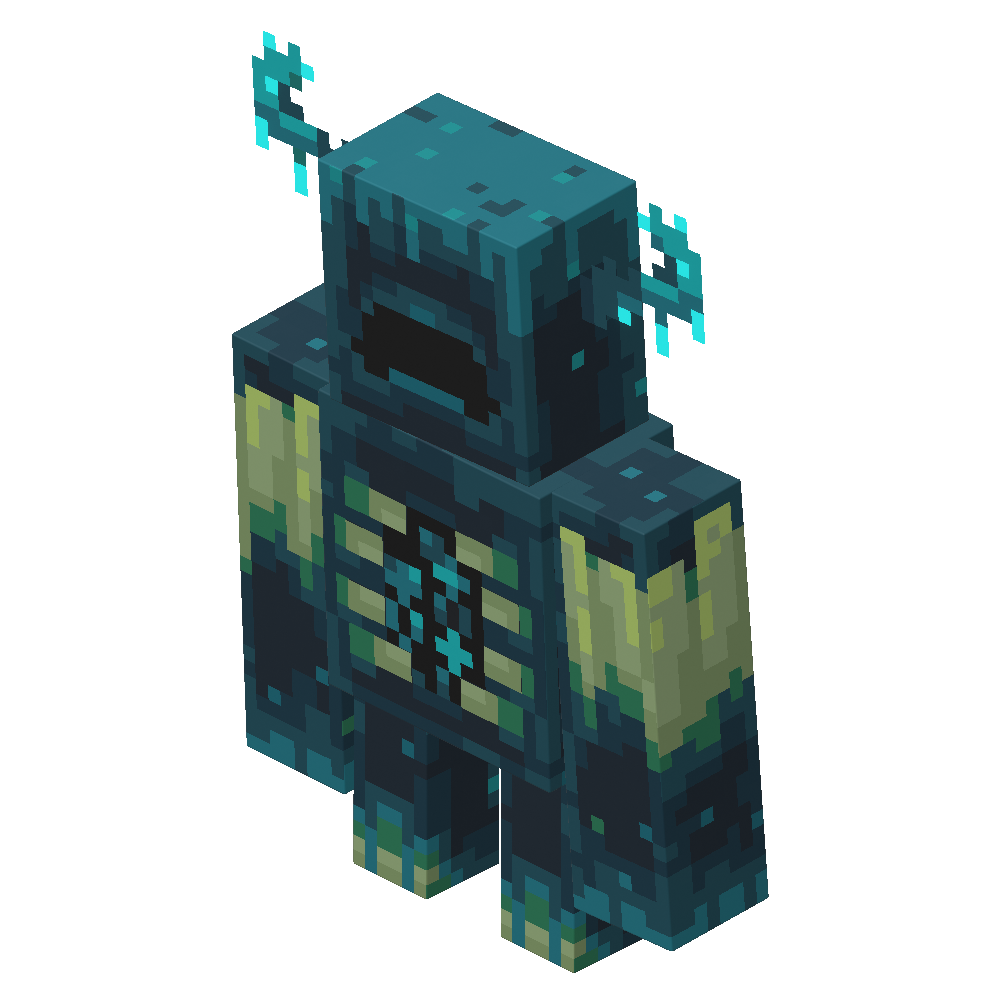
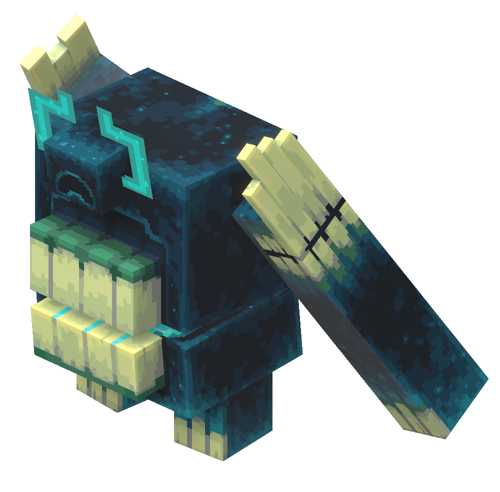
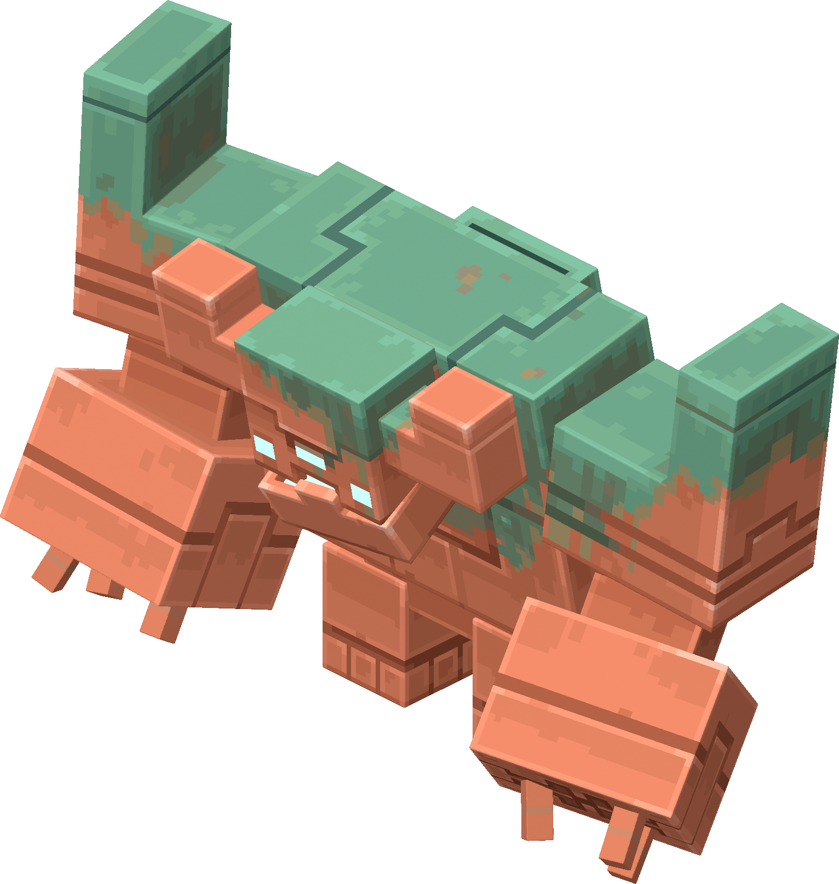
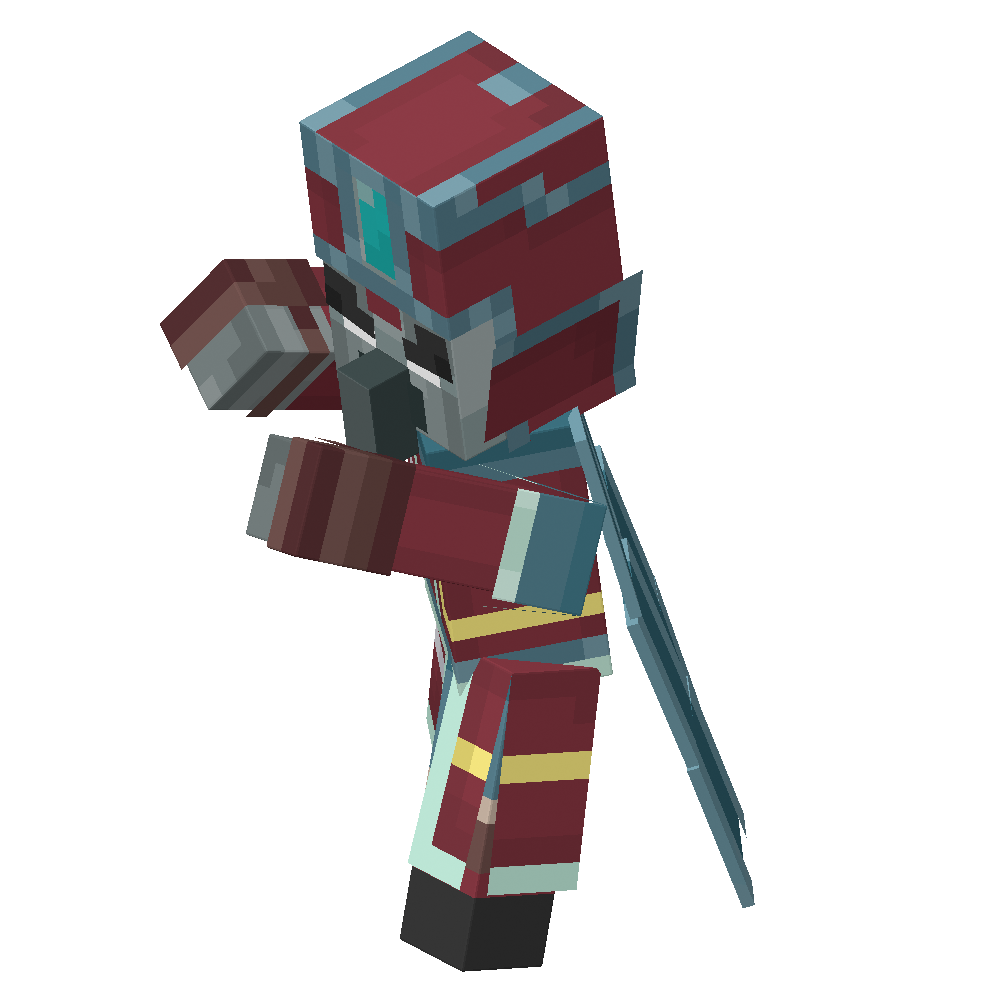
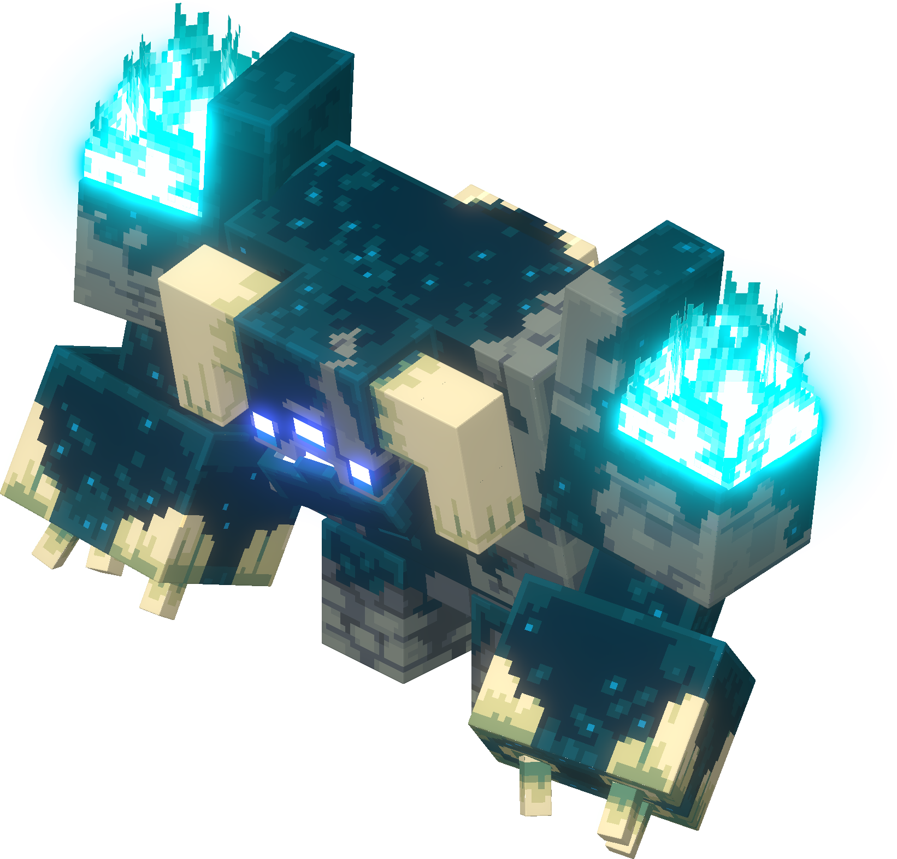
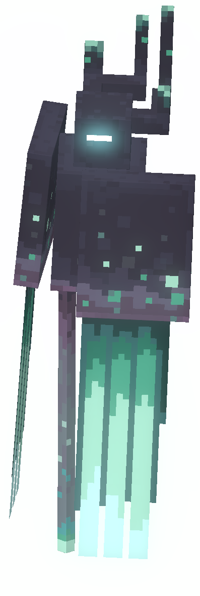
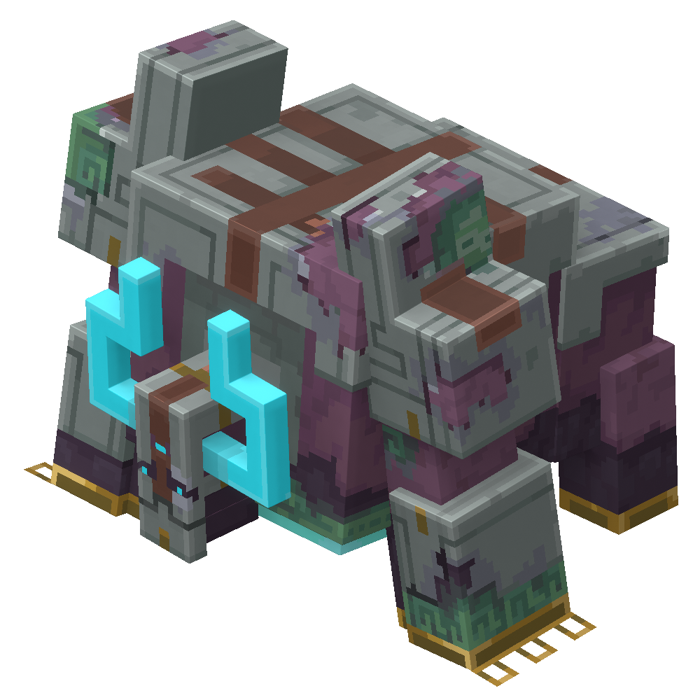
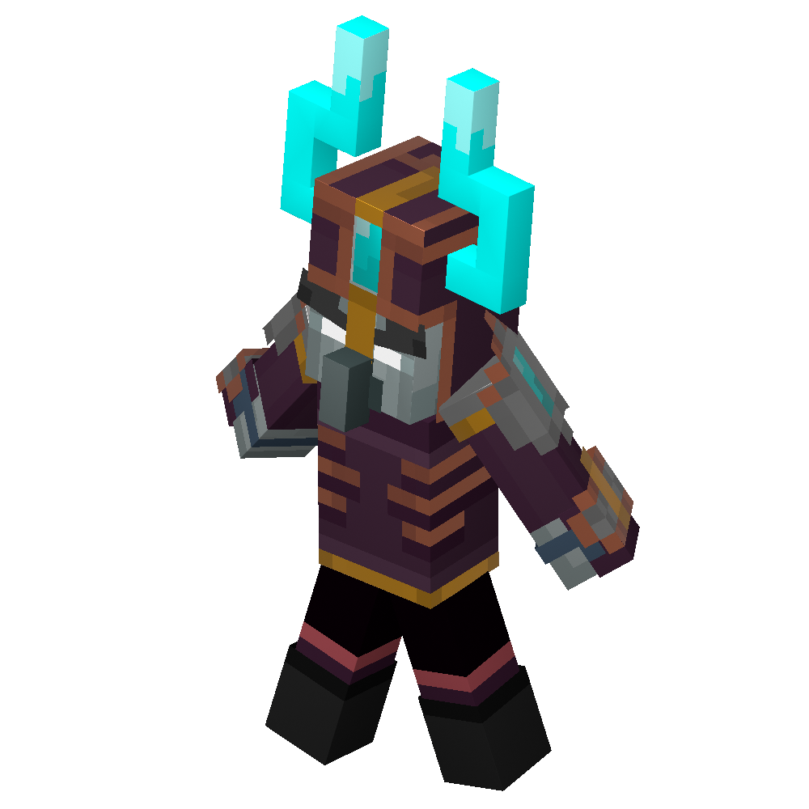
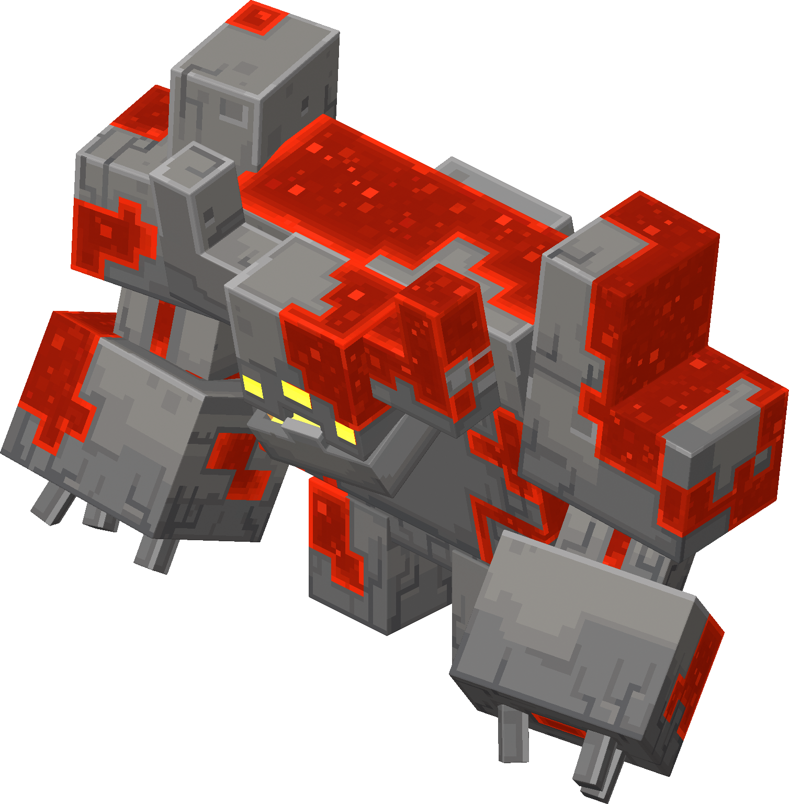

> 🧭 [回到 Minecraft Dungeons KB 總索引](/post/gaming/minecraft-dungeons-knowledge-map/)

《Minecraft Dungeons II》目前共有 **42 個任務**：**15 個主線任務＋27 個支線任務**。本篇依遊戲資料 **build 1.1.1.0** 整理，適合拿來確認主線順序、清支線，以及檢查哪些 Boss 還沒重打。

> 本文中文任務名為方便閱讀的暫譯，遊戲內辨識請以括號中的英文原名為準。版本更新若新增任務、調整前置條件或獎勵，數量可能改變。

## 先看懂任務數量

- **主線：15 個**，從 `Escape from Squid Coast` 一路到 `The Final Souldown`。
- **支線：27 個**，依區域開放，包含一般委託、Echo Golem 救援與 Boss 再戰。
- 27 個支線之中有 **7 個明確的 Boss 再戰任務**：6 個名稱帶 `Revived`，再加上 `The Final Souldown Encore`。
- `Illager Intelligence` 也包含 Sculk Monstrosity Boss 戰，所以若用「有 Boss 的支線」計算，會得到 **8 個**。

## 15 個主線任務順序

主線建議照下列順序推進；支線不必全部完成也能通關故事。

| # | 任務（中文暫譯／英文） | 主要區域 | 建議等級 | Boss／重點 | 首通 XP |
|---:|---|---|---:|---|---:|
| 1 | 逃離魷魚海岸（Escape from Squid Coast） | Squid Coast | 1 | 教學、返回營地並救出村民 | 550 |
| 2 | 裂隙來的災厄村民（The Illagers from the Rift） | Honeycomb Fields | 2 | 首次進入裂隙與 The Sift | 1,100 |
| 3 | 失蹤的商人（The Lost Merchant） | Honeycomb Fields | 2 | 救商人、取回物資並帶回 Brave Haven | 1,100 |
| 4 | 小嚎村的寂靜（The Silence in Little Howl） | Howling Woods／Little Howl | 6 | 推進村莊事件 | 2,750 |
| 5 | 與附魔匠訓練（Training with the Enchantsmith） | Brave Haven／Howling Woods | 6 | 解鎖附魔相關流程 | 2,750 |
| 6 | 森林中的腐化（Corruption in the Woods） | Howling Woods | 6 | Witch | 2,750 |
| 7 | 深入深暗之域（Down into the Deep Dark） | Howling Woods／Deep Dark | 6 | Warden、Twisted Warden | 4,180 |
| 8 | 遺失的音階盒（The Missing Note Blocks） | Howling Woods | 6 | 尋找 Note Blocks | 1,100 |
| 9 | 涉過雨原（Wading Rainy Plains） | Rainy Plains | 21 | Copper Monstrosity | 2,750 |
| 10 | 徒步冰封高地（Hiking Frozen Highlands） | Frozen Highlands／Frozen Fortress | 26 | The Prime Enchanter | 4,180 |
| 11 | 歸還音階盒（Returning the Note Blocks） | Deep Dark | 14 | 延續 Note Blocks 任務線 | 2,750 |
| 12 | 失落的和聲（Lost Harmonies） | Singer's Meadow | 33 | 推進 The Sift 主線 | 2,750 |
| 13 | 草甸中的巨獸（A Monstrosity in the Meadow） | Singer's Meadow | 33 | Sculk Monstrosity | 2,750 |
| 14 | Sculker 之怒（Wrath of the Sculkers） | Humbler Huskland | 36 | Monarch | 4,180 |
| 15 | 最終靈魂決戰（The Final Souldown） | Humbler Huskland | 36 | Monstrous Opus、主線結局 | 4,180 |

### 最短主線路線

只想先破關時，直接跟著主線標記完成上面 15 個任務即可。支線可留到主線後再清，但 `Training with the Enchantsmith` 等系統型任務會影響裝備成長，不建議跳過任務沿途的功能解鎖。

## 27 個支線任務

### Honeycomb Fields（建議等級 2）

| 任務 | 前置任務 | 內容／首通重點 | 首通 XP |
|---|---|---|---:|
| 蜂群守護者（Keeper of the Bees） | The Illagers from the Rift | 幫 Beekeeper 重建蜂巢；首通 Hivemind Hardhat | 550 |
| 苦力怕蠟燭陰謀（The Creeper Candle Conspiracy） | The Illagers from the Rift | 阻止爆破陰謀；首通 Creeper Candle | 550 |
| 打噴嚏的魔像（The Sneezing Golem） | The Missing Note Blocks | 找回 Echo Golem 的 soul block | 550 |

### Howling Woods（建議等級 6）

| 任務 | 前置任務 | 內容／首通重點 | 首通 XP |
|---|---|---|---:|
| 狼群的一員（Part of the Pack） | Training with the Enchantsmith | 救出被擄走的狼；首通 Wolf Claws | 550 |
| 牧師的學徒（The Cleric's Apprentice） | Corruption in the Woods | 救回學徒與遺失的袋子；首通 Mushroom 套裝 | 550 |
| 顫抖的魔像（The Trembling Golem） | The Missing Note Blocks | 找回 Echo Golem 的 soul block | 550 |
| 扭曲伏守者再現（The Twisted Warden Revived） | Down into the Deep Dark | **Boss 再戰**：Twisted Warden | 550 |
| 女巫再現（The Witch Revived） | Corruption in the Woods | **Boss 再戰**：Witch | 550 |

### Rainy Plains（建議等級 21）

| 任務 | 前置任務 | 內容／首通重點 | 首通 XP |
|---|---|---|---:|
| 非法災厄村民試驗（Illegal Illager Trials） | Wading Rainy Plains | 清理 Red Tower 的靈魂腐化試驗；首通 Corrupted Seeds | 550 |
| 回收你的巨獸（Recycling Your Monstrosity） | Wading Rainy Plains | 追擊車隊並回收銅；首通 Pride of the Plains | 550 |
| 銅巨獸再現（The Copper Monstrosity Revived） | Wading Rainy Plains | **Boss 再戰**：Copper Monstrosity；首通 Stormcaller | 1,100 |
| 野花戰士（Wildflower Warrior） | Wading Rainy Plains | 協助 Gatherer 採花並擊退劫毀獸 | 550 |
| 生鏽的魔像（The Rusting Golem） | Wading Rainy Plains | 找回 Echo Golem 的 soul block | 550 |

### Frozen Highlands／Frozen Fortress（建議等級 26）

| 任務 | 前置任務 | 內容／首通重點 | 首通 XP |
|---|---|---|---:|
| 去釣魚（Gone Fishing） | Hiking Frozen Highlands | 取回釣魚裝備 | 550 |
| 災厄情報（Illager Intelligence） | Hiking Frozen Highlands | 前往 Archie's Ruins；**Boss：Sculk Monstrosity** | 2,750 |
| 隧道盡頭之戰（The Fight at the End of the Tunnel） | Hiking Frozen Highlands | 救礦工並阻止奇襲；首通 Pickaxe 與 Steel Wool 套裝 | 2,750 |
| 首席附魔師再現（The Prime Enchanter Revived） | Hiking Frozen Highlands | **Boss 再戰**：The Prime Enchanter | 550 |
| 凍僵的魔像（The Freezing Golem） | Hiking Frozen Highlands | 找回 Echo Golem 的 soul block | 550 |

### Singer's Meadow（建議等級 33）

| 任務 | 前置任務 | 內容／首通重點 | 首通 XP |
|---|---|---|---:|
| Sifter 之怒（Rage of the Sifters） | Lost Harmonies | 拔除災厄村民旗幟；首通 Sifter 套裝 | 550 |
| Sculk 巨獸再現（The Sculk Monstrosity Revived） | A Monstrosity in the Meadow | **Boss 再戰**：Sculk Monstrosity | 1,100 |
| Wobble 大搜救（Wobble Run） | Lost Harmonies | 找回走失的 Wobbles | 1,100 |

### Humbler Huskland／Echo Den（建議等級 36）

| 任務 | 前置任務 | 內容／首通重點 | 首通 XP |
|---|---|---|---:|
| 浸泡靈液泉（A Dip in Ichor Springs） | Wrath of the Sculkers | 巡訪泉水並幫助 Echo Golems；首通 Oracle 套裝 | 550 |
| 拔營行動（Breaking Camps） | Wrath of the Sculkers | 處理 Echo Den 附近的災厄村民營地；首通 Paragon | 2,750 |

### Lullaby Hills（建議等級 42，主線後）

| 任務 | 前置任務 | 內容／首通重點 | 首通 XP |
|---|---|---|---:|
| 永遠的朋友（A Friend till the End） | The Final Souldown | 找回 soul block；完成後開啟 Lonesome in Lullaby Hills | 550 |
| 搖籃丘的孤獨（Lonesome in Lullaby Hills） | A Friend till the End | 闖入據點並取回 soul blocks；首通 Lullaby Blade | 550 |
| 最終靈魂決戰：安可（The Final Souldown Encore） | The Final Souldown | **Boss 再戰**：The Supreme Evoker、Monstrous Opus | 2,750 |
| 紅石巨獸再現（The Redstone Monstrosity Revived） | The Final Souldown | **Boss 再戰**：Redstone Monstrosity | 1,100 |

## 全部魔王附圖

以下收錄本文任務中會遇到的 **10 種魔王／大型敵人**。同一隻魔王若同時出現在主線和再戰支線，只列一張圖片，下面會標出所有相關任務。

### Witch（女巫）

- 出現任務：`Corruption in the Woods`
- 再戰任務：`The Witch Revived`

### Warden（伏守者）

- 出現任務：`Down into the Deep Dark`
- 這隻是前段大型敵人；同一任務最後還要打 Twisted Warden。

### Twisted Warden（扭曲伏守者）

- 出現任務：`Down into the Deep Dark`
- 再戰任務：`The Twisted Warden Revived`

#### Twisted Warden 打法

這隻王的重點不是貼身拚傷害，而是**保持中距離繞場，等旋轉結束或半血硬直時再爆發**。

1. **平常保持中距離移動**
   - 太近會連吃兩次大範圍揮拳；第二拳還會把人擊飛。
   - 不要靠牆或躲進角落，否則音波會把角色壓在牆上持續受傷。

2. **雙手張開開始旋轉：立即停手逃跑**
   - 沿競技場外圍繞圈，不要朝王身邊翻滾。
   - 旋轉約持續 7 秒；結束後 Twisted Warden 會短暫倒地，這是最安全、最大的輸出窗口。
   - 旋轉攻擊約有 20 秒冷卻，可以利用這段時間近身攻擊，但不要貪最後一刀。

3. **彎腰抓住嘴巴：準備 Sonic Boom 音波**
   - 立刻橫向跑出王面對的直線，不要只向後退。
   - 音波會持續造成傷害與擊退，並同時放出 8 枚追蹤靈魂彈。
   - 音波經過的位置會留下 soul fire；躲完不要沿原路走回去。
   - Totem of Shielding 只能短暫阻擋，音波很快就會打穿護盾，不能站著硬扛。

4. **腹部吸收靈魂並向地面噴射**
   - 這招會在場上製造多片 soul fire，踩到會受到 `Soulsick` 狀態影響。
   - 先移動到乾淨地面再輸出；安全位置比多打一輪更重要。

5. **召喚小怪時先清場**
   - 王會叫出 Excavator、Skeleton 與 Flame Construct。
   - 用範圍攻擊快速清掉遠程怪與火焰怪，但不要追到看不見王的動作。

6. **半血倒地：開啟全部爆發**
   - 血量降到一半時，Twisted Warden 會短暫跪地硬直，頭角也會改變形狀。
   - 在這段時間開啟增傷神器、近戰技能與高傷害攻擊，結束前主動拉開距離。

#### 首次主線戰可直接照抄的配裝

遊戲資料建議挑戰 Twisted Warden 時達到 **等級 16**。牠對 **近戰傷害減免 20%**、對 **靈魂傷害減免 50%**，所以核心應該是 Heavy Crossbow 的一般遠程傷害；不要把主輸出做成近戰或 soul build。

| 欄位 | 指定裝備 | 在打王前怎麼取得 | 用途 |
|---|---|---|---|
| 近戰 | **Wolf Claws** | 完成 Howling Woods 支線 `Part of the Pack`，首通保證獎勵 | 清小怪；王倒地時才近身打一輪 |
| 遠程 | **Heavy Crossbow** | 完成主線 `Corruption in the Woods`，首通保證獎勵 | 核心打王武器；平常保持距離射擊 |
| 頭部 | **Mushroom Cap** | 完成支線 `The Cleric's Apprentice`，首通給完整 Mushroom 四件 | 優先選防禦效果較好的那件 |
| 胸甲 | **Mushroom Robe** | 同上 | 同上 |
| 腿部 | **Mushroom Leggings** | 同上 | 同上 |
| 靴子 | **Mushroom Boots** | 同上 | 同上 |
| 神器 1 | **Creeper Candle** | 完成 Honeycomb Fields 支線 `The Creeper Candle Conspiracy`，首通保證獎勵 | 王召喚小怪時快速清場；冷卻 5 秒、消耗 25 souls |
| 神器 2 | **Honey Dipper** | 完成主線 `The Illagers from the Rift`，首通保證獎勵 | 控制小怪並叫蜜蜂協助；範圍 6 格、持續 8 秒 |
| 神器 3 | **Death Cap Mushroom** | Howling Woods 的敵人與寶箱隨機掉落 | 增加移動與攻速；王旋轉時拿來拉開距離 |
| 護符 1 | **Sigil of Beeswax** | 完成 `The Illagers from the Rift`，保證取得 | 最大生命增加 20%／25%／35%（護符等級 1／2／3） |
| 護符 2 | **Tasty Bone** | 完成 `The Silence in Little Howl`，保證取得 | 召喚 Wolf 幫忙攻擊；死亡 30 秒後重生 |
| 護符 3 | **現有最高等級護符** | 第一次打王前沒有第三個必拿的防禦護符 | 不必為了填滿欄位硬農後期護符 |

> Mushroom 四件沒有隱藏套裝加成。若其他防具的裝等更高，或帶有 `Protection`、`Projectile Protection`、`Elemental Protection`、`Recovery`、`Regeneration`，可以混穿，不必為了外觀強制穿齊四件。

#### 附魔與隨機效果怎麼選

- **Heavy Crossbow**：先裝 `Training with the Enchantsmith` 保證取得的 **Piercing**，用來穿透王召喚的小怪。武器若隨機帶 `Critical Hit`、`Critical Edge`、`Impact` 或 `Point Blank`，優先使用。
- **防具**：依序選 `Protection`／`Projectile Protection`／`Elemental Protection`，其次才是 `Recovery`／`Regeneration`。
- **神器觸發附魔**：若已有 `Health Synergy`，每次使用神器可回血，最適合這場；`Springload` 可在使用神器後增加移速，也很適合躲旋轉。
- 不要主堆 `Soulmancer` 或 soul damage；Twisted Warden 會減免一半靈魂傷害。

#### 沒掉 Death Cap Mushroom 怎麼辦

- 替代品：**Totem of Shielding**，同樣由 Howling Woods 的敵人或寶箱隨機掉落。
- 它能擋追蹤靈魂彈，但 Twisted Warden 的 Sonic Boom 很快會打穿圖騰；看到音波仍要橫向跑。
- Death Cap Mushroom 與 Totem of Shielding 都沒掉時，第三格直接放目前裝等最高的神器，不必卡在這裡刷到出貨才打王。

#### 進王前最短準備路線

1. `The Illagers from the Rift`：拿 **Honey Dipper＋Sigil of Beeswax**。
2. `The Creeper Candle Conspiracy`：拿 **Creeper Candle**。
3. `The Silence in Little Howl`：拿 **Tasty Bone**。
4. `Training with the Enchantsmith`：拿 **Piercing** 附魔書並解鎖附魔功能。
5. `Part of the Pack`：拿 **Wolf Claws**。
6. `Corruption in the Woods`：拿 **Heavy Crossbow**。
7. `The Cleric's Apprentice`：拿完整 **Mushroom 四件防具**。
8. 在 Howling Woods 開寶箱、清怪，把角色升到約 **16 級**；途中若掉 **Death Cap Mushroom** 或 **Totem of Shielding** 就裝上。
9. 進 `Down into the Deep Dark` 前先把 souls 補滿，再去打王。

#### 實戰按鍵順序

1. 平常繞著場地用 **Heavy Crossbow** 射擊，不用 Wolf Claws 貼身追王。
2. 王叫小怪：先放 **Honey Dipper** 控場，再用 **Creeper Candle** 清怪。
3. 王開始旋轉：開 **Death Cap Mushroom** 往外圈跑；若帶 Totem of Shielding，也不能站著硬吃旋轉或音波。
4. 王旋轉結束倒地：先射 Heavy Crossbow；安全距離足夠才切 Wolf Claws 打一套，起身前立刻退開。
5. 半血硬直時把兩個攻擊神器和遠程彈藥一次打完。

如果照這套仍被旋轉一套擊倒，先提高四件防具的裝等；不要只升武器。多人模式的 Boss 血量會依人數倍增，兩人是單人血量的 2 倍、四人是 4 倍，隊友沒有穩定輸出時不一定比單人容易。

### Copper Monstrosity（銅巨獸）

- 出現任務：`Wading Rainy Plains`
- 再戰任務：`The Copper Monstrosity Revived`

### The Prime Enchanter（首席附魔師）

- 出現任務：`Hiking Frozen Highlands`
- 再戰任務：`The Prime Enchanter Revived`

### Sculk Monstrosity（伏聆巨獸）

- 出現任務：`A Monstrosity in the Meadow`
- 支線 Boss 任務：`Illager Intelligence`
- 再戰任務：`The Sculk Monstrosity Revived`

### Monarch（君王）

- 出現任務：`Wrath of the Sculkers`

### Monstrous Opus（巨獸樂章）

- 出現任務：`The Final Souldown`
- 再戰任務：`The Final Souldown Encore`

### The Supreme Evoker（至尊喚魔者）

- 出現任務：`The Final Souldown`
- 再戰任務：`The Final Souldown Encore`

### Redstone Monstrosity（紅石巨獸）

- 再戰任務：`The Redstone Monstrosity Revived`

> 圖片為 Mojang Studios 的遊戲角色 render，由各魔王的 [Minecraft Wiki](https://minecraft.wiki/w/Minecraft_Dungeons_II) 條目收錄；本站保存本地副本供任務辨識使用。

## 建議清任務順序

1. **先推主線到新區域**：每到新區先開傳送點和商人功能。
2. **順路清同等級支線**：Honeycomb Fields → Howling Woods → Rainy Plains → Frozen Highlands → Singer's Meadow → Humbler Huskland。
3. **主線破關後去 Lullaby Hills**：這裡的 4 個支線建議等級 42，屬於後日談與高價值再戰。
4. **最後集中打 Boss 再戰**：需要指定裝備或想快速練操作時，再刷 `Revived`／`Encore` 任務。

## Boss 支線速查

- **一般 Boss 支線**：Illager Intelligence（Sculk Monstrosity）。
- **明確再戰 7 個**：The Prime Enchanter Revived、The Twisted Warden Revived、The Witch Revived、The Copper Monstrosity Revived、The Sculk Monstrosity Revived、The Redstone Monstrosity Revived、The Final Souldown Encore。

## 資料來源與口徑

- [MetaBot：Minecraft Dungeons II 全 42 任務](https://metabot.gg/en/minecraft-dungeons-2/quests)：遊戲資料 build 1.1.1.0 的主線順序、區域、前置、XP、Boss 與獎勵。
- [MetaBot：Twisted Warden 數值、抗性與掉落](https://metabot.gg/en/minecraft-dungeons-2/bosses/twisted-warden)：建議等級、招式傷害、近戰／靈魂抗性、多人血量倍率與任務獎勵。
- [MetaBot：資料來源方法](https://metabot.gg/en/minecraft-dungeons-2/methodology)：說明遊戲資料擷取與版本口徑。
- [Minecraft Wiki：Minecraft Dungeons II quests 分類](https://minecraft.wiki/w/Category:Minecraft_Dungeons_II_quests)：已建立的任務頁與官方展示內容。

部分網站顯示 38 個任務，是較早資料或未收齊後期支線；另有網站寫成「15 主線＋20 支線＋7 Boss 再戰」，總數仍是 42，只是把 7 個再戰從支線中拆開計算。本文統一採遊戲內分類：**15 主線＋27 支線＝42**。
