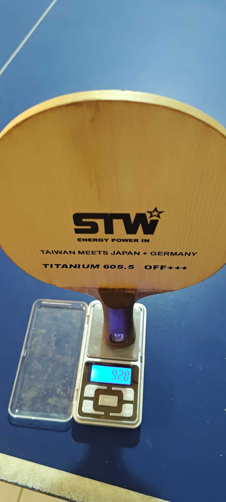
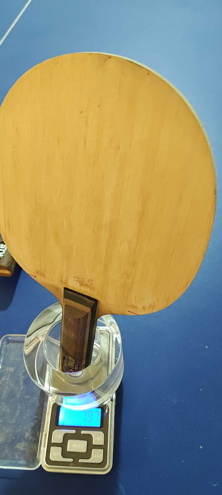
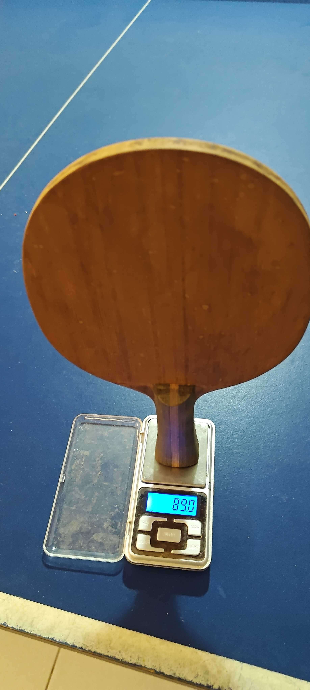

# 我的桌球器材清單 (My Table Tennis Equipment)

這是一份記錄目前個人擁有的桌球底板與訓練器材的清單。涵蓋從傳統 PH 到現代纖維，以及發球機與特殊重量訓練器材。

## 一、 實戰底板系列

### 1. 展瑞PH (1-Ply Hinoki)
*   **結構：** 單層（1 ply）
*   **層構成：** 檜木單板（約 10mm 厚）
*   **特性：** 具有極佳的噴射感與柔和的吃球感。單板特有的厚實手感與強大的底勁，是弧圈球與推擋的經典選擇。
*   **手感重點：** 追求「通透」與「噴彈」的極致平衡。
*   **目前貼法：** 正手黑色 AK47 紅海綿 / 反手紅色 AK47 藍海綿。
*   **目前實打體感：** 雙面 AK47 的整體速度偏慢。
*   **目前定位：** 現階段最重要的訓練拍，負責手感、低位、連動與主幹建立；速度偏慢不影響其動作校正用途，但不把這組配置當成速度基準。

### 2. 艾銳斯虎鯨結構 (Arylate Carbon Hinoki)
*   **結構：** 5 + 2 夾層
*   **層構成：** 檜木面材 → Arylate Carbon 纖維 → 軟木內層 → 大芯 → 軟木內層 → Arylate Carbon 纖維 → 檜木面材
*   **特性：** 結合了檜木的柔和手感與芳碳纖維的均衡支撐與大甜區。相比純檜，出球速度更快，甜區更大且穩定。
*   **手感重點：** 速度快、旋轉好，適合現代全方位進攻打法。

### 3. 神木 Starwood TFH (Titanium Fiber Hinoki)
*   **品牌：** 台灣神木 Starwood
*   **結構：** 5 + 2 夾層
*   **層構成：** 檜木面材 → 鈦纖維 → 軟木內層 → 大芯 → 軟木內層 → 鈦纖維 → 檜木面材
*   **特性：** 鈦纖維提供了非常獨特的金屬手感，剛性強且震動吸收快。搭配檜木面材可以中和金屬的生硬感。
*   **手感重點：** 擊球感紮實，指向性極佳，適合追求「一擊必殺」爆發力的打法。
*   **G-1 試打紀錄：** 正手 Fastarc G-1 MAX／反手 G-1 特厚，整體體感好打；此項是配膠相容性紀錄，不代表目前仍貼著 G-1。

### 4. 純碳纖維 (T300 3K Carbon Fiber)
*   **結構：** 全碳纖維
*   **層構成：** T300 3K 碳纖維編織多層結構
*   **特性：** 極限的速度與硬度。脫板速度極快，能輕易打出高品質的快攻球，但對使用者的控球能力要求較高。
*   **手感重點：** 硬、快、暴力，適合近台快攻。
*   **目前貼法：** 正手紅色 Fastarc G-1 MAX / 反手黑色 Fastarc G-1 特厚。
*   **目前定位：** 近台快節奏、快攻與前衝對照拍；交換 G-1 後，回饋比原 AU 金／藍鯨配置明顯更扎實。

### 5. XVT 外置碳 (XVT External Carbon)
*   **結構：** 5 + 2 夾層
*   **層構成：** 面材 → 外置編織碳纖維 → 內層 → 阿尤斯（Ayous）大芯 → 內層 → 外置編織碳纖維 → 面材
*   **特性：** 專為 40+ 新材料球設計的全碳科技底板。外置碳纖維提供強勁的出球速度，阿尤斯大芯兼顧底勁與吞吐感。95g±5g 的重量適中，OFF+ 級別。
*   **手感重點：** 速度 135、控制 90、旋轉 80，兼具暴力與一定的控制能力。
*   **目前貼法：** 正手黑色 AU（金標）/ 反手紅色海夫藍鯨。
*   **目前整拍實秤：** 187.6g；下一輪優先以反手 41～43g 的中硬輕量膠，將整拍降到約 180g。
*   **目前定位：** 弧圈控球與高容錯對照拍；木芯形變補足膠皮支撐後，交換配置的扎實感優於原雙面 G-1 體感。

### 6. Andro Kinetic Explorer
*   **結構：** 5 + 2 夾層（巴沙木大芯 + Kinetic 動能系統）
*   **層構成：** 面材 → 碳纖維 → 內層 → 巴沙木（Balsa）大芯 → 內層 → 碳纖維 → 面材 + 空心動能握柄（內含碳珠）
*   **材質特性：** 舊世代控制取向底板。巴沙木密度極低，靠厚度硬撐彈性但底勁不足；空心動能握柄吸震過度，手感傳遞有斷層。
*   **現況：** 目前仍有貼皮可使用，尚未戰損退役。
*   **目前貼法：** 正手黑色 T88 Ultra Spin / 反手紅色 水星 2。
*   **目前實打體感：** 這組配置的整體速度偏慢。
*   **目前定位：** 舊拍 / 備用拍 / 低價練習線。
*   **目前結論：** 以現代 40+ 塑料球來看，這支在底勁、正手球速、反手借力防守與整體比賽兌現率上都明顯不足，**不適合再拿來當正式對戰拍**。

> **📝 備註：** YEO 已因拍面拔絲戰損退役。

---

## 二、 訓練器材 (Training Tools)

### 1. 600g 鋼材練習拍
*   **用途：** 增強前臂與手腕的小肌肉群力量，提升揮拍的穩定度。

### 2. 1200g 鋼材練習拍
*   **用途：** 核心力量與爆發力訓練。提升還原速度與揮拍速度。

### 3. AKKADI TW 2700-08 雙輪桌球發球機
*   **功能：** 支援固定、隨機與自訂球路，可設定旋轉、速度、落點、長短球、球數與訓練時間。
*   **用途：** 單項技術定型、左右步法、長短球銜接與全檯反應訓練。
*   **詳細整理：** [AKKADI TW 2700-08 桌球發球機：功能、規格與訓練應用](/post/table-tennis/akkadi-tw2700-08/)

---

## 三、膠皮庫存與目前使用狀態

> **膠皮壽命等級說明（貼上底板後，依海綿發泡技術與膠面特性分級）：**
> * 🟢 **耐用型**：低張力海綿 + 澀性膠面，彈性衰退曲線平緩，正常使用可維持 4 個月以上。
> * 🟡 **標準型**：中高張力海綿或內能海綿。海綿彈性會隨時間衰退，壽命約 2–4 個月。
> * 🔴 **敏感型**：黏性膠面或高張力海綿衰退快的類型，出廠狀態好但衰退明顯，約 1–3 個月。
>
> ⚠️ **建議只為常用底板貼皮，其餘保持未拆封保存（未拆封可撐 2–3 年）。**

### 🔴 紅色膠皮 (Red)
*   **Rakza 7 Soft MAX** 🟡：成熟反手線，兼顧擰拉、近台主動與容錯。
*   **海夫藍鯨** 🔴：目前紅色膠皮裝在 XVT 反手；未充分灌膠或衰退後的動態支撐會降低，但配合木芯仍可形成柔順、易吃球的手感。
*   **銀河 9000D** 🟡：平價中硬取向，可作正手備用 / 試打膠。
*   **Sanwei T88 Ultra Spin** 🔴：支撐力佳，但海綿衰退快。

### ⚫ 黑色膠皮 (Black)
*   **Nittaku Fastarc G-1 MAX／特厚** 🟡：目前裝在純碳正反手；中硬海綿支撐能接住純碳剛性，交換後回饋乾脆扎實。
*   **LOKI 銳龍 1 金版** 🟢：平價偏個性線，可作試打或副拍配置。
*   **Sanwei AU（金標）** 🟡：目前黑色膠皮裝在 XVT 正手；此張實測在純碳上較易出現透板與發空，換到有木芯行程的 XVT 後更柔順扎實。

---

---

## 四、目前使用狀態

本節是個人器材「目前狀態」的唯一資料源；其他配置比較與升級文章只保留原理或當時案例，若有衝突，以本節和頁首 `lastmod` 為準。

### 主力底板 × 膠皮重量矩陣（2026-11-11）

本表以 5 支主力比較底板與 3 組主力雙面膠皮為範圍。Andro Kinetic Explorer 與其 T88 Ultra Spin＋銀河水星 2 配置仍保留在持有器材紀錄，但已退出這份主力重量比較。

#### 基準重量

| 類型 | 代號／配置 | 重量 |
|---|---|---:|
| 底板 | F：alex 檜木藍芳碳 | 79.7g |
| 底板 | D：展瑞 PH 檜木單板 | 89.0g |
| 底板 | B：XVT 碳纖面材 | 89.1g |
| 底板 | A：神木 Starwood TFH 檜木鈦纖 | 92.8g |
| 底板 | C：純碳纖維 | 102.1g |
| 雙面膠皮 | X：AK47 紅海綿＋AK47 藍海綿 | 81.0g（單面平均約 40.5g） |
| 雙面膠皮 | Z：兩面 Fastarc G-1（特厚＋MAX） | 98.5g |
| 雙面膠皮 | Y：Sanwei AU 金＋海夫藍鯨 | 101.5g |

#### 空板實秤照片與待補項目

以下照片為目前已留存的空板實秤證據，秤面讀值依序為神木 Starwood TFH 92.8g、alex 檜木藍芳碳 79.7g、展瑞 PH 檜木單板 89.0g。

後續補量／補照片清單：

- [ ] **Andro Kinetic Explorer：** 目前沒有空板實秤數字；日後拆皮時補量並拍照。
- [ ] **XVT 外置碳：** 已記錄空板 89.1g，尚缺秤重照片；日後拆皮時補拍即可，不必為了照片提前拆皮。
- [ ] **純碳纖維：** 已記錄空板 102.1g，尚缺秤重照片；日後拆皮時補拍即可，不必為了照片提前拆皮。

主力比較的五支底板均已有空板重量數字；目前真正缺少重量數字的現役／備用板只有 Andro Kinetic Explorer。已退役的 YEO 不列入必補項目，除非日後要保留完整歷史檔案。

膠皮重量均為裁切後雙面合計，含基本膠水層。矩陣中的主數字為「空板＋雙面膠皮」的算術試算；括號內另列整拍實秤，兩者可能因實際裁切面積、膠水量、護邊與個體差異而不同。

#### 完整重量與配膠體感對照

| 底板 | 空板 | ＋X：AK47 紅＋藍 | ＋Z：雙面 G-1 | ＋Y：AU 金＋藍鯨 |
|---|---:|---:|---:|---:|
| F：alex 檜木藍芳碳 | 79.7g | **160.7g** 🟢 | **178.2g** 🟢 **過慢** | **181.2g** 🟢 |
| D：展瑞 PH 檜木單板 | 89.0g | **170.0g** 🟢（實秤 170.0g） **過慢** | **187.5g** 🟡 | **190.5g** 🔴 |
| B：XVT 碳纖面材 | 89.1g | **170.1g** 🟢 | **187.6g** 🟡（實秤 187.6g） **好打** | **190.6g** 🔴（實秤 193g，含護邊） **好打** |
| A：神木 Starwood TFH 檜木鈦纖 | 92.8g | **173.8g** 🟢 | **191.3g** 🔴（實秤 191.3g） **好打** | **194.3g** 🔴 |
| C：純碳纖維 | 102.1g | **183.1g** 🟡 | **200.6g** 🔴（實秤 200.6g） **好打** | **203.6g** 🔴（實秤 201.1g） **發空** |

體感只標記已實際打過的組合；沒有標記的格子代表目前沒有實打結論，不等於不好打。

負荷色標是個人目前用來安排試拍順序的工作區間，不是通用醫療界線：

- 🟢 **黃金擺速區：≤ 182.0g**。優先用於反手近台快撕、急停與長時間連續轉換。
- 🟡 **臨界負荷區：182.1～188.9g**。需觀察兩小時高強度相持後的前臂伸肌與煞車代償感。
- 🔴 **重度負荷區：≥ 189.0g**。拍頭慣性明顯，若高頻反手轉換時出現累積痠痛，就不列入主力長時配置。

由重量單看，F 板對三組膠皮都有最大的配膠餘裕；D、B 板搭雙面 G-1 已進入臨界區；A、C 板搭 G-1 或 AU 金＋藍鯨則超過目前的 189g 重度負荷線。重量只決定負荷與慣性的一部分，實際選擇仍需和重心、板型、握柄、膠皮動態支撐及實打體感一起判斷。

### 近期跨底板／配膠實打紀錄（2026-11-10）

以下只記錄本人主觀體感，不把單次結果外推成所有同結構底板的定律；速度感也會受裸板重量、厚度、平衡點、膠皮厚度與擊球方式影響。

| 底板／結構 | 配膠 | 實打體感 | 判讀 |
|---|---|---|---|
| PH 單檜 | 正手 AK47 紅海綿／反手 AK47 藍海綿 | 速度偏慢 | 保留為手感與動作訓練配置；目前只能確認整組速度感，尚未用交換測試拆分紅、藍海綿各自的影響。 |
| Andro Kinetic Explorer | 正手 T88 Ultra Spin／反手銀河水星 2 | 速度偏慢 | 與既有的正手球速、底勁及反手借力不足結論一致；只作備用或低價練習線，不再作正式對戰拍。 |
| XVT 外置編織碳＋木芯 | 正手 G-1 MAX／反手 G-1 特厚 | 好打 | G-1 在這支板上能正常形成支撐與持球，並非失配；目前改貼 AU 金／藍鯨，是另一組同樣成立的配置。 |
| 純碳纖維 | 正手 G-1 MAX／反手 G-1 特厚 | 好打、扎實乾脆 | 與 AU 金／藍鯨的發空體感形成明顯對照。 |
| 神木 Starwood TFH 鈦纖維 | 正手 G-1 MAX／反手 G-1 特厚 | 好打 | 目前先保留為成功試打紀錄，尚未拆分速度、旋轉與控制的細項評分。 |
| 外置藍芳碳試打板（檜木面材、檜木大芯） | 正手 G-1 MAX／反手 G-1 特厚 | 覺得速度很慢 | 已知面材與大芯都是檜木，並非典型 Viscaria 的 Koto 面材＋Kiri 大芯結構。四組 G-1 的正反手厚度相同，因此速度差異不能歸因於厚度配置不同；此結果只代表這支特定板，不能直接推論所有外置 ALC 配 G-1 都慢。後續仍需補記型號、裸板與整拍重量。 |
| 純碳纖維 | 正手 AU 金／反手海夫藍鯨 | 很空 | 同一組膠換到 XVT 後體感成立，支持問題主要在底板與膠皮的動態匹配，而不是膠皮單獨好壞。 |
| XVT 外置編織碳＋木芯 | 正手 AU 金／反手海夫藍鯨 | 好打 | 木芯提供第二段形變，能接住這組膠皮在純碳上不足的支撐行程。 |

| 球拍 | 目前配置 | 現在角色 | 下一步 |
|---|---|---|---|
| PH 單檜 | 正手 AK47 紅海綿／反手 AK47 藍海綿；速度偏慢 | 主訓練、手感與動作校正 | 配置固定，避免頻繁換拍 |
| XVT 外置碳 | 正手 AU 金／反手海夫藍鯨；187.6g | 現代外置板驗收、弧圈與容錯對照 | 第一輪只換反手 AK47 Red，目標約 179～181g |
| 純碳 | 雙面 Fastarc G-1 | 近台快節奏、快攻與前衝對照 | 維持配置，低頻驗證即可 |
| KE | 正手 T88 Ultra Spin／反手銀河水星 2；速度偏慢 | 備用、低壓力練習 | 不再作正式對戰主拍 |
| ACH／TFH | 尚未定案 | 長期候選與風格對照 | 等現有主線穩定後再評估，不先預設配膠 |

### 使用原則

- **PH 負責穩定累積：** 練低位、回中、正手連動與反手主動。
- **XVT 負責現代節奏驗收：** 檢查反手快撕、借力與正反手銜接，但先處理 187.6g 的負擔。
- **純碳只作特化對照：** 用來看拍面穩定與近台一速，不與主線搶訓練量。
- **KE、ACH、TFH 不參與目前主線競爭。**

---

## 五、下一個器材變更

目前只安排一個變因：

1. 保留 XVT 正手 AU 金。
2. 將反手海夫藍鯨改為裁切後約 41～43g 的 AK47 Red。
3. 換皮後記錄整拍重量、平衡點、反手快撕與兩小時訓練後的前臂負擔。
4. 若已降到約 180g 但正手支撐仍不足，再單獨評估正手膠；不兩面同時更換。

詳細試算見：[純碳與 XVT 的底板膠皮阻抗匹配案例](/post/table-tennis/blade-rubber-impedance-matching-case/)。

---

## 六、相關專題

- [桌球器材升級路線圖：從 PH 到 XVT 的規劃與目前修正版](/post/table-tennis/equipment-roadmap/)
- [桌球膠皮配置比較：AK47 vs G-1／R7 Soft vs T05／T19](/post/table-tennis/rubber-setup-comparison/)
- [底板與膠皮阻抗匹配案例：純碳、XVT、G-1、AU 金與藍鯨](/post/table-tennis/blade-rubber-impedance-matching-case/)
- [桌球器材 KB 統合入口](/post/table-tennis/equipment-hub/)

---

## 七、保養與存放

- 放在球拍套或穩定乾燥的環境，避免高溫、日曬與長時間潮濕。
- 定期檢查底板受潮、面材拔絲、膠皮氧化與翹邊。
- 每次換皮記錄日期、裁切後重量、整拍重量與配置，避免只靠記憶比較。
